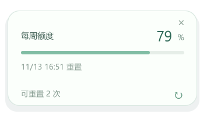

# Codex 白龙桌宠


Windows 上陪伴 Codex 工作的透明桌宠，支持任务状态同步、剩余额度查看和 92 个角色动作。

**Rust 单 EXE 预览版：[v0.5.0-preview.4](https://github.com/Miraclemarvel/codex-desktop-pet/releases/tag/v0.5.0-preview.4)** · **Electron 稳定版：[v0.4.1](https://github.com/Miraclemarvel/codex-desktop-pet/releases/tag/v0.4.1)**

**角色与动画素材来自 [hunmer/aboutme-pets 的 GPT 动作包](https://github.com/hunmer/aboutme-pets/tree/main/pets/gpt)，由 hunmer 生成。感谢原作者提供素材！本项目负责桌宠程序与 Codex 接入。**


## 下载与使用

- **[下载 Rust 单 EXE（Windows x64，约 130 MiB）](https://github.com/Miraclemarvel/codex-desktop-pet/releases/download/v0.5.0-preview.4/CodexPet-Rust-Windows-x64-v0.5.0-preview.4.exe)**：放在固定文件夹后双击运行。全部动画内嵌，无需 Electron、Node.js、WebView 或额外资源文件。详见 [Rust 版使用与编译说明](docs/rust.md)。
- **[下载 Electron 稳定版安装包](https://github.com/Miraclemarvel/codex-desktop-pet/releases/tag/v0.4.1)**：解压后双击 `安装并启动.cmd`。无需安装 Node.js；请保留解压后的文件夹位置。

两种版本均不需要管理员权限。从 Electron 切换到 Rust 时，先关闭旧版的“随 Codex 启停”并退出。Rust 版升级时，先在旧版右键选择“退出并关闭后台监听”，再运行新版 EXE。

- Codex 打开时自动出现，Codex 主进程退出后自动结束；最小化 Codex 时继续陪伴。不显示托盘图标，也不占任务栏。
- 点击角色或状态条查看账号剩余额度、重置时间；卡片打开时每分钟刷新，也可手动刷新。Rust 版卡片左下角以小字显示可用重置次数。
- 按住角色拖动；右键可恢复到屏幕内、查看动作图鉴、调整大小与画面效果。
- 待机动态可选 **静态、安静、适中、活泼**。默认安静，约每 3 分钟播放一个小动作，其余时间轻微呼吸。
- 任务工作、等待确认、完成与异常会触发对应动作。静态待机也保留任务和交互反馈。
- 右键“退出桌宠（本次 Codex）”只退出本次会话；右键关闭“随 Codex 启停”或运行 `关闭自动启动.cmd`，可取消自动跟随。

Rust 版偏好保存在 `%APPDATA%/Codex Desktop Pet Rust/settings.json`；Electron 版保存在 `%APPDATA%/Codex Desktop Pet/settings.json`。升级会保留已有偏好。

Rust 版额度卡片（演示数据）：



## 状态与额度接入

通过当前 Windows 用户的 Codex 桌面本地管道读取真实任务状态与账号额度，仅允许调用 `list_threads` 和 `get_usage_limits` 两种只读工具，无需额外模型调用。额度显示账号共享的剩余百分比与重置时间，不估算剩余消息数；没有返回的数据会标记不可用，刷新失败时标记缓存。

后台每 3.5 秒查询最近 50 个聊天及置顶聊天，并订阅活跃聊天状态。程序仅保留状态判断所需字段，丢弃收到的对话正文与工具参数，不上传到外部服务器。

当前适配在 Codex Windows **26.1106.6628.0** 上验证，使用桌面应用内部管道协议，Codex 更新后可能需要调整。远程任务状态取决于 Codex 是否连接对应主机。本项目为独立社区程序，与 OpenAI 无隶属关系。

Rust 版通过同一个 EXE 的后台监听模式等待 Codex，再启动桌宠窗口。Electron 版的 `CodexPetHost.exe` 是无窗口、无托盘的 .NET 监听程序。两者均无需修改 Codex 安装文件或快捷方式。

## 开发与打包

Rust 版需要 Windows x64、Rust stable（MSVC）、Visual Studio C++ 编译工具及 Windows SDK、Python 3：

```powershell
powershell.exe -NoProfile -ExecutionPolicy Bypass -File scripts/build-rust.ps1
```

EXE 图标来自“元气挥手”第 48 帧笑脸头像，内嵌 16–256 像素的十种尺寸。来源记录见 [assets/ICON_SOURCE.json](assets/ICON_SOURCE.json)。

应用逻辑集中在 [rust/codex_pet.rs](rust/codex_pet.rs)，构建依赖由 `rust/Cargo.toml` 和 `rust/Cargo.lock` 记录。脚本生成内嵌素材包、运行 16 项 Rust 测试，并输出单个 EXE 与 SHA-256 校验文件。

Electron 版需要 Node.js 24+；生成 ZIP 还需要 Python 3。编译宿主使用 Windows 自带的 .NET Framework C# 编译器：

```powershell
npm ci
npm test
npm start

# 在尚无 outputs/release/CodexPet 的干净工作目录中打包
npm run pack
python scripts/archive.py
```

源码在 `src/`，测试在 `tests/`，原生宿主源码在 `native/`。完整 92 张原始精灵图随仓库提供；需要重新下载时，在 PowerShell 7 中运行 `./scripts/download-assets.ps1`，脚本固定到已核对的上游版本。

验证范围及版本修复记录见 [Rust 版记录](docs/rust.md#接入与验证) 和 [Electron 版记录](docs/verification.md)。GitHub Actions 分别运行 16 项 Rust 测试及单 EXE 编译、20 项 Electron 版测试；这些检查不代替真实 Codex、Windows 登录或跨机器验证。

## 素材来源与许可说明

- 作者：[hunmer](https://github.com/hunmer)
- 原始仓库：[aboutme-pets](https://github.com/hunmer/aboutme-pets)
- 原始素材目录：[pets/gpt](https://github.com/hunmer/aboutme-pets/tree/main/pets/gpt)
- 本项目使用的 92 张 WebP 精灵图及两份动作清单，均与上游提交 [`4f8e9e3`](https://github.com/hunmer/aboutme-pets/commit/4f8e9e327bad8c137d98d8ec591712af920de8b7) 逐文件核对；清单见 [assets/SOURCE.json](assets/SOURCE.json)。
- 保留 [上游 README](assets/UPSTREAM-README.md) 和原始素材，不将角色或动画声明为本项目原创，不另行授予其许可。

更多第三方与许可信息见 [THIRD_PARTY_NOTICES.md](THIRD_PARTY_NOTICES.md)。
